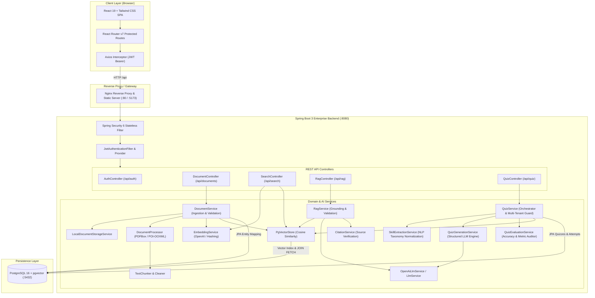

# Cognivault AI — Enterprise AI Knowledge Assistant

Cognivault AI is an enterprise-grade, production-quality personal AI Knowledge Assistant built with Java 21, Spring Boot 3, PostgreSQL, pgvector, React, Vite, and Tailwind CSS.

---

## 🏛️ Production Architecture



---

## 🔒 Security & Hardening Architecture

1. **Strict Multi-Tenant Isolation**:
   - Every document and chunk is scoped to the authenticated user ID (`WHERE user_id = :authenticated_user_id`).
   - Cross-user access or deletion attempts automatically return `401 Unauthorized` / `403 Forbidden`.
   - Vector similarity search candidate retrieval executes optimized SQL with `JOIN FETCH`, preventing in-memory leakage or cross-tenant visibility.

2. **File Upload Hardening**:
   - **Path Traversal Defense**: Rejects any filenames containing `..`, `/`, or `\`.
   - **MIME Blacklisting**: Blocks script and executable content types (`text/html`, `application/javascript`, `application/x-dosexec`).
   - **PDF Magic Byte Verification**: Validates the `%PDF-` file header directly from the input stream to prevent spoofed file extensions.
   - **Storage Isolation**: Stored files are renamed to random UUIDs and isolated from the user's raw client filename.

3. **Production Error Masking & Structured Logging**:
   - `GlobalExceptionHandler` logs full exception stack traces to internal SLF4J logs without exposing SQL queries or server internals to HTTP clients.
   - Dedicated handlers for `MaxUploadSizeExceededException`, `AccessDeniedException`, and validation errors.

4. **Configurable CORS**:
   - Reads allowed origins dynamically from `cognivault.security.cors.allowed-origins` / `CORS_ALLOWED_ORIGINS`.

---

## 📡 API Reference

### 1. Authentication Endpoints

#### `POST /api/auth/register`
Creates a new user account and returns a signed JWT.
- **Request Body**:
  ```json
  {
    "name": "Alex Morgan",
    "email": "alex@company.com",
    "password": "Password123!"
  }
  ```
- **Response (`201 Created`)**:
  ```json
  {
    "token": "eyJhbGciOiJIUzM4NCJ9...",
    "tokenType": "Bearer",
    "user": {
      "id": 1,
      "name": "Alex Morgan",
      "email": "alex@company.com",
      "role": "USER",
      "createdAt": "2026-10-14T22:40:22"
    }
  }
  ```

#### `POST /api/auth/login`
Authenticates user credentials and issues a JWT token.
- **Request Body**:
  ```json
  {
    "email": "alex@company.com",
    "password": "Password123!"
  }
  ```
- **Response (`200 OK`)**: Same schema as register.

#### `GET /api/auth/me`
Retrieves current user profile from JWT session.
- **Headers**: `Authorization: Bearer <TOKEN>`
- **Response (`200 OK`)**: User details.

---

### 2. Document Management Endpoints

#### `POST /api/documents/upload`
Uploads and indexes a PDF, TXT, or DOCX document.
- **Headers**: `Authorization: Bearer <TOKEN>`, `Content-Type: multipart/form-data`
- **Form Param**: `file` (Binary file <= 10MB)
- **Response (`201 Created`)**:
  ```json
  {
    "id": 12,
    "userId": 1,
    "fileName": "4e72f8a1-3cb5-4f36-932d-2092d6e35eb1.pdf",
    "originalFileName": "system-design.pdf",
    "fileType": "PDF",
    "fileSize": 1048576,
    "status": "PROCESSED",
    "pageCount": 8,
    "chunkCount": 34,
    "createdAt": "2026-10-14T22:45:00"
  }
  ```

#### `GET /api/documents`
Lists all documents owned by the authenticated user.
- **Headers**: `Authorization: Bearer <TOKEN>`
- **Response (`200 OK`)**: `{ "documents": [...], "count": 1 }`

#### `GET /api/documents/{id}`
Retrieves metadata for a specific document (verifies ownership).
- **Headers**: `Authorization: Bearer <TOKEN>`

#### `GET /api/documents/{id}/chunks`
Retrieves all indexed vector chunks for a specific document.
- **Headers**: `Authorization: Bearer <TOKEN>`
- **Response (`200 OK`)**:
  ```json
  [
    {
      "id": 101,
      "documentId": 12,
      "chunkIndex": 0,
      "content": "Raw chunk content...",
      "characterCount": 980,
      "createdAt": "2026-10-14T22:45:02"
    }
  ]
  ```

#### `DELETE /api/documents/{id}`
Permanently deletes a document, its physical file, and its vector embeddings.
- **Headers**: `Authorization: Bearer <TOKEN>`
- **Response (`204 No Content`)**

---

### 3. Vector Search & RAG Endpoints

#### `POST /api/search`
Performs vector similarity search across document chunks.
- **Headers**: `Authorization: Bearer <TOKEN>`
- **Request Body**:
  ```json
  {
    "query": "microservices fault tolerance",
    "topK": 5,
    "documentId": 12
  }
  ```
- **Response (`200 OK`)**:
  ```json
  {
    "query": "microservices fault tolerance",
    "results": [
      {
        "chunkId": 101,
        "documentId": 12,
        "content": "Circuit breaker patterns prevent cascading failures...",
        "similarityScore": 0.884,
        "metadata": { "chunkIndex": 0, "documentName": "system-design.pdf" }
      }
    ]
  }
  ```

#### `POST /api/rag/query`
Generates grounded responses with source citations using retrieved vector context.
- **Headers**: `Authorization: Bearer <TOKEN>`
- **Request Body**:
  ```json
  {
    "query": "What are the core technical features described in the documents?",
    "topK": 5,
    "documentId": null
  }
  ```
- **Response (`200 OK`)**:
  ```json
  {
    "answer": "The core technical features include document ingestion pipelines, pgvector similarity search, and source grounding [S1].",
    "citations": [
      {
        "documentId": 12,
        "chunkId": 101,
        "documentName": "system-design.pdf",
        "chunkIndex": 0,
        "pageNumber": 1,
        "similarityScore": 0.884
      }
    ],
    "sourcesUsed": 1
  }
  ```

---

### 5. Quiz Arena Endpoints

#### `POST /api/quiz/generate`
Generates a structured, anti-duplicate technical assessment.
- **Headers**: `Authorization: Bearer <TOKEN>`
- **Request Body**:
  ```json
  {
    "documentId": 12,
    "mode": "SKILL_BASED",
    "difficulty": "INTERMEDIATE",
    "questionCount": 5,
    "categories": ["CONCEPTUAL", "CODING", "DEBUGGING", "SCENARIO"],
    "topicFocus": "Spring Boot & PostgreSQL"
  }
  ```
- **Response (`200 OK`)**:
  ```json
  {
    "id": 45,
    "documentId": 12,
    "documentName": "FullStack_Resume.pdf",
    "mode": "SKILL_BASED",
    "difficulty": "INTERMEDIATE",
    "topicFocus": "Spring Boot & PostgreSQL",
    "totalQuestions": 5,
    "createdAt": "2026-11-17T17:00:00",
    "extractedSkills": ["Java", "Spring Boot", "React", "PostgreSQL"],
    "questions": [
      {
        "id": 101,
        "questionText": "In Spring Boot, how does the @Transactional annotation manage database rollbacks by default?",
        "options": [
          "Rolls back on any checked or unchecked exception",
          "Rolls back on RuntimeException and Error, but not checked exceptions",
          "Rolls back only if manual rollback is called",
          "Never rolls back automatically"
        ],
        "category": "CONCEPTUAL",
        "difficulty": "INTERMEDIATE",
        "groundingType": "TECHNICAL_KNOWLEDGE",
        "skillTag": "Spring Boot",
        "codeSnippet": null,
        "sourceCitation": null
      }
    ]
  }
  ```
  *(Note: `correctAnswerIndex` and `explanation` are deliberately hidden from this response for anti-cheat security)*

#### `POST /api/quiz/{id}/submit`
Submits user answers for server-side evaluation and returns scored results with full explanations.
- **Headers**: `Authorization: Bearer <TOKEN>`
- **Request Body**:
  ```json
  {
    "answers": {
      "101": 1,
      "102": 0
    }
  }
  ```
- **Response (`200 OK`)**:
  ```json
  {
    "quizId": 45,
    "attemptId": 7,
    "score": 5,
    "totalQuestions": 5,
    "percentage": 100.0,
    "completedAt": "2026-11-17T17:05:00",
    "topicBreakdown": {
      "Spring Boot": { "correct": 3, "total": 3, "percentage": 100.0 },
      "PostgreSQL": { "correct": 2, "total": 2, "percentage": 100.0 }
    },
    "difficultyBreakdown": {
      "INTERMEDIATE": { "correct": 5, "total": 5, "percentage": 100.0 }
    },
    "questionResults": [
      {
        "questionId": 101,
        "questionText": "In Spring Boot, how does the @Transactional annotation manage database rollbacks by default?",
        "options": ["..."],
        "selectedOptionIndex": 1,
        "correctOptionIndex": 1,
        "isCorrect": true,
        "explanation": "@Transactional rolls back automatically for unchecked exceptions (subclasses of RuntimeException) and Error by default.",
        "category": "CONCEPTUAL",
        "difficulty": "INTERMEDIATE",
        "groundingType": "TECHNICAL_KNOWLEDGE",
        "skillTag": "Spring Boot",
        "codeSnippet": null,
        "sourceCitation": null
      }
    ]
  }
  ```

#### `GET /api/quiz`
Retrieves past quiz history and attempt metrics for the authenticated user.

#### `GET /api/quiz/{id}`
Retrieves a specific quiz. If previously submitted, includes the user's latest scores and answers.

#### `GET /api/quiz/skills/{documentId}`
Previews skills extracted from an uploaded document (e.g. resume) categorized into Languages, Frameworks, Databases, Tools, and AI/ML.

#### `GET /api/quiz/{id}/evaluate`
Audits the technical quality and grounding faithfulness of generated questions using `QuizEvaluationService`.

---

## 🧠 Quiz Arena 2.0 — Intelligent AI Assessment Engine

The upgraded Quiz Arena is an intelligent assessment system designed to evaluate real technical competency rather than superficial document trivia.

### 1. Three Specialized Generation Modes

| Mode | Grounding Target | Description |
| :--- | :--- | :--- |
| **Document-Based** | 100% Retrieved Chunks | Questions are strictly grounded in document content using vector retrieval. Citations `[S1]` reference source chunks. Unsupported facts are rejected. |
| **Skill-Based** | Technical Knowledge | Extracts skills from resumes (e.g., Java, Spring Boot, React, MongoDB) and generates deep technical conceptual, coding, and debugging questions testing real-world understanding rather than resume trivia. |
| **Mixed Assessment** | 50% Docs / 50% Skills | Combines document-grounded questions with deep technical skill assessments. Each question is clearly tagged as `DOCUMENT_GROUNDED` or `TECHNICAL_KNOWLEDGE`. |

### 2. Multi-Dimensional Assessment Controls

- **Difficulties**: `BEGINNER` (foundational syntax & definitions), `INTERMEDIATE` (real-world patterns, concurrency, indexing), `ADVANCED` (internals, JVM garbage collection, distributed systems).
- **Categories**: Multi-select support across:
  - *Conceptual Questions*
  - *Coding Questions* (includes executable syntax snippets)
  - *Debugging Questions* (pinpoints bugs and memory leaks)
  - *Scenario-Based Questions* (architectural tradeoffs)
  - *Output Prediction*
  - *Real-World Systems*
- **Question Counts**: 5, 10, 15, or 20 questions.
- **Topic Focus**: Custom focus query (e.g., `Java Concurrency & Virtual Threads`, `Spring Security OAuth2 & JWT`).

### 3. Uniqueness Engine & Anti-Duplicate Hashing
- Computes SHA-256 signatures of normalized question stems.
- Stores historical signatures per user in `quiz_questions` database table.
- Injects previous user signatures as a negative constraint in LLM prompt generation to guarantee fresh, unseen questions on every attempt.

### 4. Cheat-Proof Server-Side Evaluation
- Clients receive only questions and shuffled options during the active quiz.
- Correct answer indices and explanations are stored server-side.
- The `/api/quiz/{id}/submit` endpoint validates answers, calculates topic-wise and difficulty-wise performance breakdowns, and persists attempt logs.

### 5. Automated Evaluation & Quality Auditor
- `QuizEvaluationService` calculates real quantitative metrics on every generated quiz:
  - **Skill Relevance Rate**: Percentage of questions directly testing identified skills.
  - **Technical Accuracy Rate**: Validates code blocks, singular correct answers, and plausible distractors.
  - **Duplicate Rate**: Verifies 0% intra-quiz and historical duplicate collisions.
  - **Distractor Quality Rate**: Ensures distinct, non-trivial answer choices.
  - **Grounding Faithfulness**: Ensures document-based questions cite verified chunks.

---

## 🚀 Deployment Instructions

### Option 1: Full-Stack Docker Compose (Recommended for Production)

Run the entire stack with PostgreSQL + pgvector, Spring Boot 3, and React + Nginx:

```bash
# 1. Clone repository
git clone https://github.com/your-org/cognivault-ai.git
cd cognivault-ai

# 2. Copy and configure production environment variables
cp .env.example .env
# Edit .env and supply your OPENAI_API_KEY and a secure JWT_SECRET

# 3. Start all services in detached mode
docker compose up --build -d

# 4. Check container health status
docker compose ps
```

- **Frontend**: `http://localhost` (or `http://localhost:5173`)
- **Backend API**: `http://localhost:8080`
- **PostgreSQL**: `localhost:5432`

---

### Option 2: Local Development Execution

#### 1. Start Spring Boot Backend
```bash
cd backend
.\mvnw.cmd spring-boot:run
```
*(Runs on `http://localhost:8080` with in-memory H2 PostgreSQL mode by default)*

#### 2. Start React Frontend
```bash
cd frontend
npm install
npm run dev
```
*(Runs on `http://localhost:5173` with reverse proxy to `http://127.0.0.1:8080`)*

---

## 🧪 Testing Commands

Run the full automated test suite (including unit, integration, and security tests):

```bash
cd backend
.\mvnw.cmd test
```

**Results**: All **58 tests** pass 100%:
- `AuthIntegrationTest`: Register, login, JWT validation.
- `SecurityAndValidationTest`: Path traversal rejection, fake PDF header rejection, executable rejection, and cross-user isolation.
- `DocumentIntegrationTest`: Multi-format parsing, chunking, and deletion.
- `SearchIntegrationTest`: Scoped vector similarity queries.
- `RagIntegrationTest`: Grounded answer generation, no-context guard, citation validation.
- `ResumeRagIntegrationTest`: Grounded resume extraction and skills grounding.
- `SkillExtractionServiceTest`: Technical skill parsing, ontology normalization, category grouping, and assessment topic generation.
- `QuizGenerationServiceTest`: Prompt construction, structured schema parsing, code validation, and duplicate signature generation.
- `QuizEvaluationServiceTest`: Accuracy rate, duplicate rate, skill relevance, and citation grounding metrics auditing.
- `QuizIntegrationTest`: Multi-mode quiz creation, cheat-proof retrieval, answer submission scoring, and topic breakdown verification.

---

## 📸 UI Walkthrough & Screenshots Placeholder

| View | Path | Description |
| :--- | :--- | :--- |
| **Authentication** | `/login` & `/register` | Dark-themed login with demo autofill and JWT storage. |
| **Dashboard** | `/dashboard` | Metrics cards (Documents, Chunks, Pages, Grounding Score), vector search tester. |
| **Documents** | `/documents` | Drag & drop PDF uploader with progress bar, status badges, and deletion modal. |
| **Document Details** | `/documents/:id` | Deep chunk inspection, character counts, chunk search, copy actions. |
| **AI Chat (RAG)** | `/chat` | Conversational RAG with document scope selector, citations `[S1]`, metadata modals. |
| **Quiz Arena** | `/quiz` | Multi-mode AI technical assessment engine (Document, Skill, Mixed) with category toggles, code rendering, server scoring, and audit metrics. |
| **User Profile** | `/profile` | Account details, active JWT inspector, storage footprint. |

---

## ✅ Production Readiness Checklist

- [x] Java 21 & Spring Boot 3 enterprise runtime.
- [x] Stateless JWT authentication with HS384/HS512 support.
- [x] Strict user isolation on all endpoints (SQL-level filtering).
- [x] Path traversal and malicious MIME/magic-byte upload defenses.
- [x] Production error masking via `GlobalExceptionHandler` with zero secret leaks.
- [x] Structured SLF4J logging across all services and filters.
- [x] Database query optimization: eliminated N+1 queries with `JOIN FETCH`.
- [x] Configurable production environment properties (`application-prod.yml`, `.env.example`).
- [x] Multi-stage backend Dockerfile (Alpine JRE runtime, non-root user).
- [x] Multi-stage frontend Dockerfile (Node 22 builder + Nginx Alpine runtime).
- [x] Production `docker-compose.yml` with `pgvector/pgvector:pg16` database service.
- [x] 58 / 58 automated tests passing 100%.
- [x] Production SPA routing fallback and reverse proxy configured in Nginx.
- [x] Intelligent Quiz Arena with 3 generation modes, anti-duplicate hashing, and server-side cheat-proof scoring.
